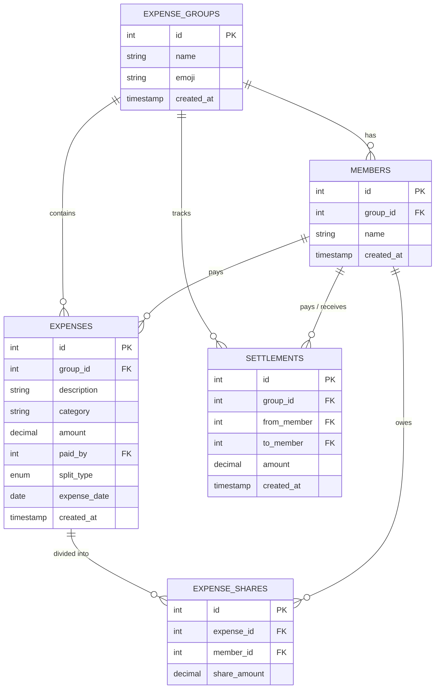

# 💸 SplitCalc — Smart Splitwise Calculator

> **Calculate first. Split second. Settle up with zero awkward math.**

SplitCalc is a full-stack expense sharing and bill splitting web application designed to simplify shared finances for roommates, trips, dinners, and group events. It combines an **interactive in-app bill calculator** (with one-click tax, tip, and split computations) with **exact integer-math splitting algorithms** and **greedy debt simplification** to minimize the number of payments needed to settle up.

---

## 📑 Table of Contents

- [✨ Features](#-features)
- [🛠 Tech Stack](#-tech-stack)
- [📂 Project Structure](#-project-structure)
- [🧮 How It Works](#-how-it-works)
  - [Exact Paise Arithmetic](#1-exact-paise-arithmetic-no-floating-point-errors)
  - [Split Strategies](#2-split-strategies)
  - [Debt Simplification Algorithm](#3-debt-simplification-algorithm)
- [🗄️ Database Schema](#️-database-schema)
- [🚀 Getting Started](#-getting-started)
  - [Prerequisites](#prerequisites)
  - [1. Database Setup](#1-database-setup)
  - [2. Backend Setup](#2-backend-setup)
  - [3. Frontend Setup](#3-frontend-setup)
- [🧪 Running Unit Tests](#-running-unit-tests)
- [📡 API Documentation](#-api-documentation)
- [⚙️ Environment Variables](#️-environment-variables)
- [🚢 Deployment](#-deployment)
- [📄 License](#-license)

---

## ✨ Features

- **📱 Smart Bill Calculator Modal:**
  - Built-in arithmetic calculator with parenthesis, decimal, and expression history support.
  - One-click shortcuts for **18% GST**, **10% Tip**, and **N-way splits**.
  - **"Use result"** button directly inserts the calculated total into the expense creation form.

- **⚖️ Multiple Split Modes:**
  - **Equal Split:** Splits the bill equally among participants, cleanly distributing leftover paise so the sum matches the exact total.
  - **Percentage Split:** Assign custom percentages to each member; validates 100% total with precise rounding.
  - **Custom Split:** Specify exact rupee amounts per participant with total balance verification.

- **🤝 Minimal-Transfer Debt Simplification:**
  - Computes net balance for every member across all expenses and settlements.
  - Solves the debt settlement graph using a greedy two-pointer algorithm that pairs the largest debtor with the largest creditor to minimize total transactions.

- **👥 Groups & Member Management:**
  - Organize expenses by group (e.g. *Trip to Goa*, *Flatmates*, *College Friends*).
  - Add custom emojis, track member lists, and monitor group-wide spending.

- **💳 Settlement Recording:**
  - Record direct peer-to-peer settlements ("Person A paid Person B ₹X") that immediately update balances.

- **🎨 Modern Responsive UI:**
  - Designed with React 18, Vite, Lucide icons, and modern CSS with smooth animations, custom avatar stacks, stat cards, and responsive tables.

---

## 🛠 Tech Stack

### Frontend
- **Framework:** [React 18](https://react.dev/) + [Vite 6](https://vitejs.dev/)
- **Routing:** [React Router v6](https://reactrouter.com/)
- **Icons:** [Lucide React](https://lucide.dev/)
- **Styling:** Vanilla CSS with custom design tokens, modern typography, and glassmorphism

### Backend
- **Runtime:** [Node.js](https://nodejs.org/) (CommonJS)
- **Framework:** [Express 5](https://expressjs.com/)
- **Database:** [MySQL](https://www.mysql.com/) with [`mysql2/promise`](https://github.com/sidorares/node-mysql2) connection pooling
- **Security & Utilities:** `cors`, `dotenv`
- **Testing:** Node.js native `assert` test suite

---

## 📂 Project Structure

```text
Splitwise-Calculator/
├── backend/                  # Express REST API & Database logic
│   ├── utils/
│   │   ├── balances.js       # Net balance & debt simplification algorithms
│   │   ├── errors.js         # Custom HttpError class
│   │   └── splits.js         # Paise conversions & split calculations
│   ├── .env.example          # Sample environment variables
│   ├── db.js                 # MySQL connection pool configuration
│   ├── package.json          # Backend dependencies & scripts
│   ├── schema.sql            # MySQL database schema & tables
│   ├── server.js             # Express API routes & error handling
│   └── test.js               # Unit tests for splitting & balance logic
│
├── splitcalc-frontend/       # React SPA frontend (Vite)
│   ├── src/
│   │   ├── App.jsx           # Main application, routes, pages & calculator modal
│   │   ├── index.css         # Design system & styles
│   │   └── main.jsx          # React DOM entry point
│   ├── index.html            # HTML template
│   ├── package.json          # Frontend dependencies & scripts
│   ├── vercel.json           # SPA rewrites for Vercel deployment
│   └── vite.config.js        # Vite configuration
│
└── README.md                 # Project documentation
```

---

## 🧮 How It Works

### 1. Exact Paise Arithmetic (No Floating-Point Errors)
In financial software, standard IEEE 754 floating-point arithmetic (`0.1 + 0.2 === 0.30000000000000004`) causes rounding errors. 

SplitCalc converts every monetary value into integer **paise** (1 Rupee = 100 Paise) before performing any calculations:
```javascript
const toPaise = (n) => Math.round(Number(n) * 100);
const fromPaise = (p) => p / 100;
```
All database calculations and algorithms operate strictly on integers, guaranteeing that shares and totals always match to the exact paisa.

### 2. Split Strategies
- **Equal Split:**
  $$\text{base} = \lfloor \text{total} / N \rfloor, \quad \text{remainder} = \text{total} \pmod N$$
  The remainder is distributed one paisa at a time across the first $R$ participants.
- **Percentage Split:**
  Each participant is assigned $\lfloor \text{total} \times \text{pct}_i / 100 \rfloor$, and any leftover paise are distributed cyclically.
- **Custom Split:**
  Validates that $\sum \text{amounts} = \text{total}$, throwing a descriptive `400 Bad Request` if there is any discrepancy.

### 3. Debt Simplification Algorithm
Without simplification, in a group of $N$ people there can be up to $\mathcal{O}(N^2)$ individual debts. SplitCalc resolves this using a greedy matching algorithm:
1. Calculate each member's **Net Balance**:
   $$\text{Net} = \text{Total Paid} - \text{Total Owed} + \text{Settlements In} - \text{Settlements Out}$$
2. Partition members into **Creditors** ($\text{Net} > 0$) and **Debtors** ($\text{Net} < 0$).
3. In each step, match the member with the **largest debt** with the member who is **owed the most**. Transfer $\min(\text{debt}, \text{credit})$, update balances, and repeat until all balances are zero.
4. Produces at most $N - 1$ payments.

---

## 🗄️ Database Schema

The database uses relational integrity with foreign keys and cascade deletions.



---

## 🚀 Getting Started

### Prerequisites
- [Node.js](https://nodejs.org/) (v18 or higher recommended)
- [npm](https://www.npmjs.com/)
- [MySQL Server](https://dev.mysql.com/downloads/) (local installation or cloud instance like PlanetScale / Aiven)

---

### 1. Database Setup

1. Start your local MySQL service.
2. Run the provided `schema.sql` file to create the database and tables:
   ```bash
   mysql -u root -p < backend/schema.sql
   ```
   *(Or copy-paste the contents of `backend/schema.sql` into MySQL Workbench, phpMyAdmin, or your preferred SQL GUI).*

---

### 2. Backend Setup

1. Navigate to the backend directory:
   ```bash
   cd backend
   ```
2. Install dependencies:
   ```bash
   npm install
   ```
3. Create your `.env` configuration file from the template:
   ```bash
   cp .env.example .env
   ```
4. Update `.env` with your MySQL credentials:
   ```env
   PORT=5000
   DB_HOST=localhost
   DB_PORT=3306
   DB_USER=root
   DB_PASSWORD=your_mysql_password
   DB_NAME=splitwise_calculator
   DB_SSL=false
   CORS_ORIGIN=http://localhost:5173
   ```
5. Start the backend in development mode (with auto-reload):
   ```bash
   npm run dev
   ```
   The backend server will run at `http://localhost:5000`.

---

### 3. Frontend Setup

1. Open a new terminal and navigate to the frontend directory:
   ```bash
   cd splitcalc-frontend
   ```
2. Install dependencies:
   ```bash
   npm install
   ```
3. Start the Vite development server:
   ```bash
   npm run dev
   ```
4. Open [http://localhost:5173](http://localhost:5173) in your browser.

---

## 🧪 Running Unit Tests

The backend includes zero-dependency automated unit tests verifying the exact split computations, edge cases (odd amounts, rounding remainders), and debt simplification logic:

```bash
cd backend
npm test
```

Expected output:
```text
> backend@2.0.0 test
> node test.js

All tests passed ✅
```

---

## 📡 API Documentation

Base URL: `http://localhost:5000/api`

### Groups

| Method | Endpoint | Description |
|---|---|---|
| `GET` | `/groups` | List all groups with member counts and total expenses |
| `POST` | `/groups` | Create a new group with initial members |
| `GET` | `/groups/:id` | Get group details and member list |
| `POST` | `/groups/:id/members` | Add a new member to an existing group |

#### Create Group Request Body:
```json
{
  "name": "Trip to Goa",
  "emoji": "🌴",
  "members": ["Alex", "Maya", "Arjun", "Riya"]
}
```

---

### Expenses

| Method | Endpoint | Description |
|---|---|---|
| `GET` | `/expenses` | Get all expenses (supports `?group_id=:id` filter) |
| `POST` | `/expenses` | Record a new expense and compute member shares |
| `DELETE` | `/expenses/:id` | Delete an expense and its associated shares |

#### Record Expense Request Body (Equal Split):
```json
{
  "group_id": 1,
  "description": "Seafood Dinner",
  "category": "Food & drink",
  "amount": 2400.00,
  "paid_by": 1,
  "participants": [1, 2, 3, 4],
  "split_type": "equal",
  "expense_date": "2026-10-14"
}
```

#### Record Expense Request Body (Percentage Split):
```json
{
  "group_id": 1,
  "description": "Hotel Suite",
  "amount": 10000.00,
  "paid_by": 1,
  "participants": [1, 2],
  "split_type": "percentage",
  "shares": {
    "1": 60,
    "2": 40
  }
}
```

---

### Balances & Settlements

| Method | Endpoint | Description |
|---|---|---|
| `GET` | `/groups/:id/balances` | Get net balances and simplified debt settlement transfers |
| `POST` | `/settlements` | Record a settlement payment between two members |

#### Balances Response Example:
```json
{
  "group_id": 1,
  "balances": [
    { "member_id": 1, "name": "Alex", "balance": 1800 },
    { "member_id": 2, "name": "Maya", "balance": -600 },
    { "member_id": 3, "name": "Arjun", "balance": -600 },
    { "member_id": 4, "name": "Riya", "balance": -600 }
  ],
  "transfers": [
    { "from": 2, "from_name": "Maya", "to": 1, "to_name": "Alex", "amount": 600 },
    { "from": 3, "from_name": "Arjun", "to": 1, "to_name": "Alex", "amount": 600 },
    { "from": 4, "from_name": "Riya", "to": 1, "to_name": "Alex", "amount": 600 }
  ]
}
```

#### Record Settlement Request Body:
```json
{
  "group_id": 1,
  "from_member": 2,
  "to_member": 1,
  "amount": 600.00
}
```

---

## ⚙️ Environment Variables

### Backend (`backend/.env`)

| Variable | Default | Description |
|---|---|---|
| `PORT` | `5000` | Port for the Express server |
| `DB_HOST` | `localhost` | MySQL database host |
| `DB_PORT` | `3306` | MySQL database port |
| `DB_USER` | `root` | MySQL database user |
| `DB_PASSWORD` | *(empty)* | MySQL database password |
| `DB_NAME` | `splitwise_calculator` | MySQL database name |
| `DB_SSL` | `false` | Enable SSL for cloud databases (e.g. `true`) |
| `CORS_ORIGIN` | `http://localhost:5173` | Allowed CORS origin for frontend |

---

## 🚢 Deployment

### Frontend (Vercel)
The `splitcalc-frontend` folder is pre-configured with `vercel.json` rewrites for single-page application routing:
1. Connect your repository to [Vercel](https://vercel.com/).
2. Set the **Root Directory** to `splitcalc-frontend`.
3. Build command: `npm run build`
4. Output directory: `dist`

### Backend (Render / Railway / VPS)
1. Deploy the `backend/` directory to any Node.js hosting platform (e.g. Render, Railway, DigitalOcean).
2. Set `NODE_ENV=production`.
3. Provide production MySQL database environment variables (`DB_HOST`, `DB_USER`, `DB_PASSWORD`, `DB_NAME`, `DB_SSL=true`).
4. Update `CORS_ORIGIN` to match your deployed frontend domain.

---

## 📄 License

This project is licensed under the [ISC License](backend/package.json).
